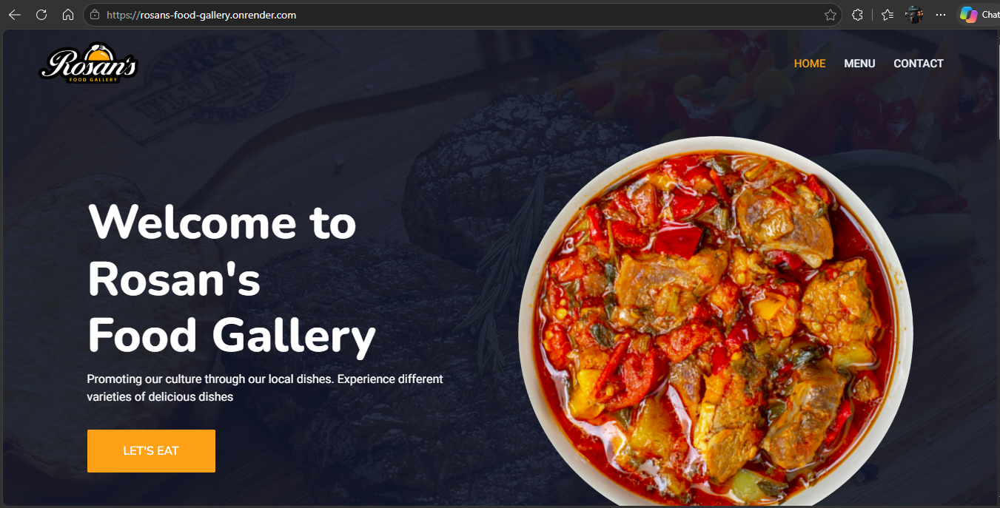
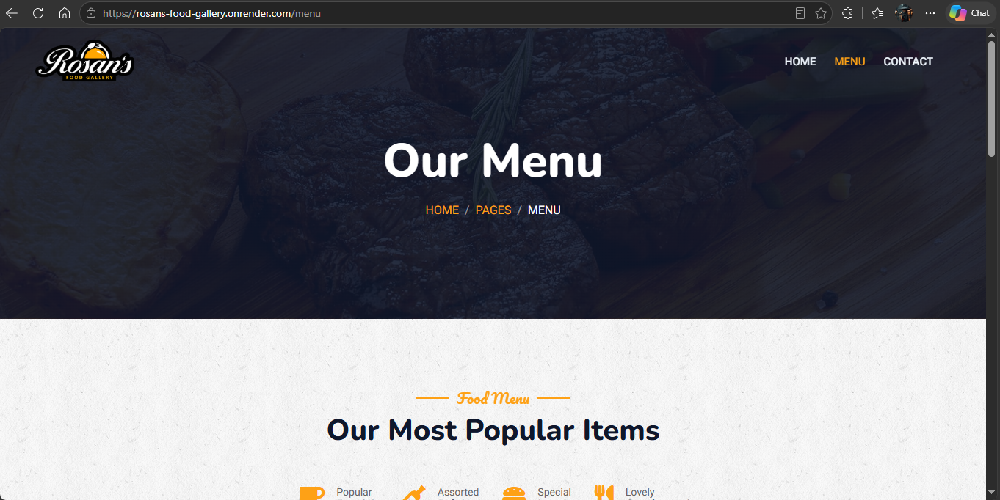
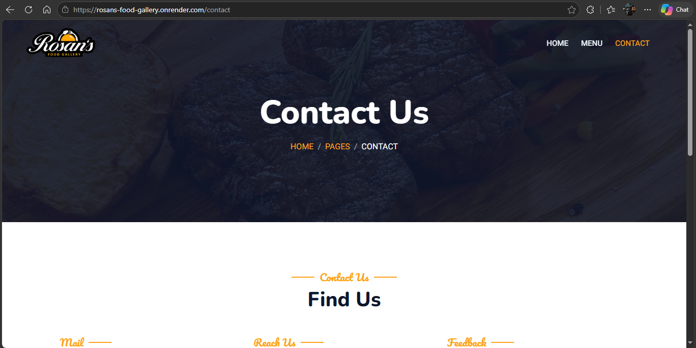
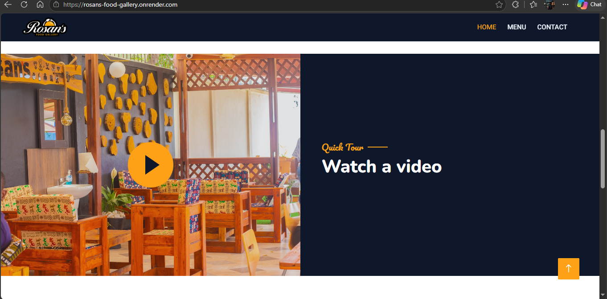
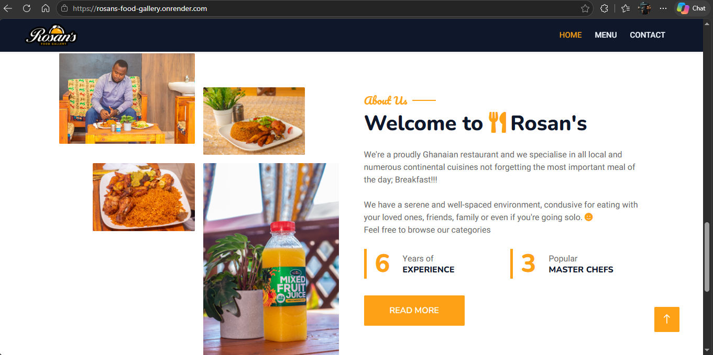
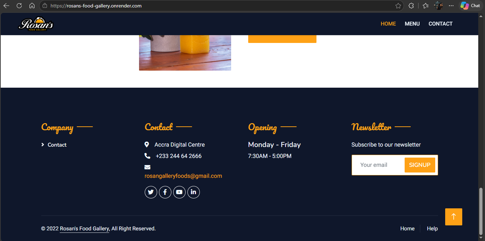
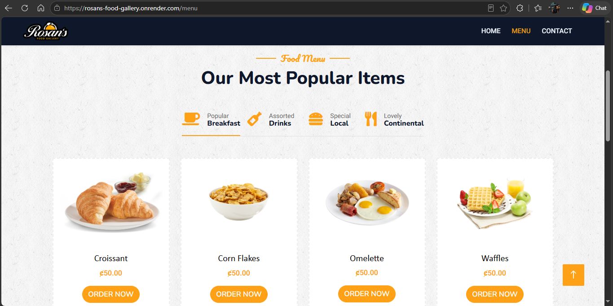
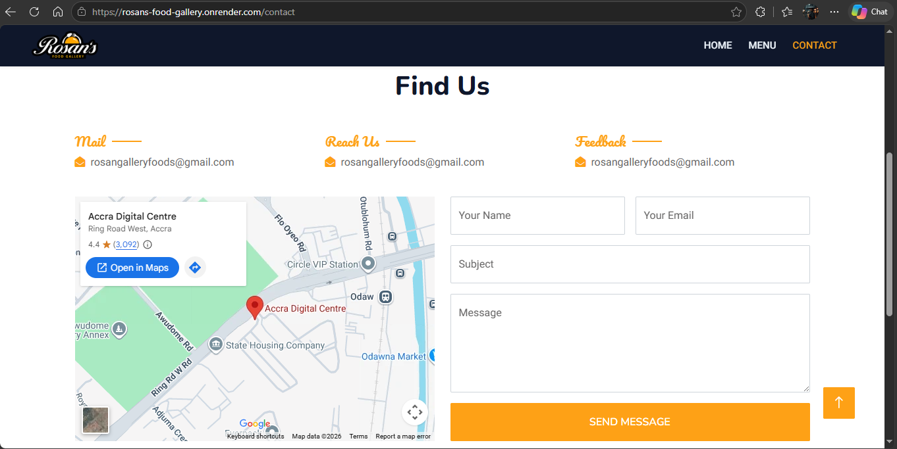

# Rosans-_Food_Gallery - Using Node.js and MongoDB

## Create .env file
Create a .env file to store your MongoDB database credentials

```
MONGODB_URI = 'mongodb+srv://<username>:<password>@cluster-a.n5knf1h.mongodb.net/?retryWrites=true&w=majority'
DATABASE_NAME = 'your db name'
```

## Installation
To run this project, install it locally using npm:

```
$ npm install
$ node server.js
```

## Run this command if you have nodemon installed locally using npm:

```
$ nodemon server.js
```

## Screenshots

## Homepage


## Menu


## Contact


## Other





